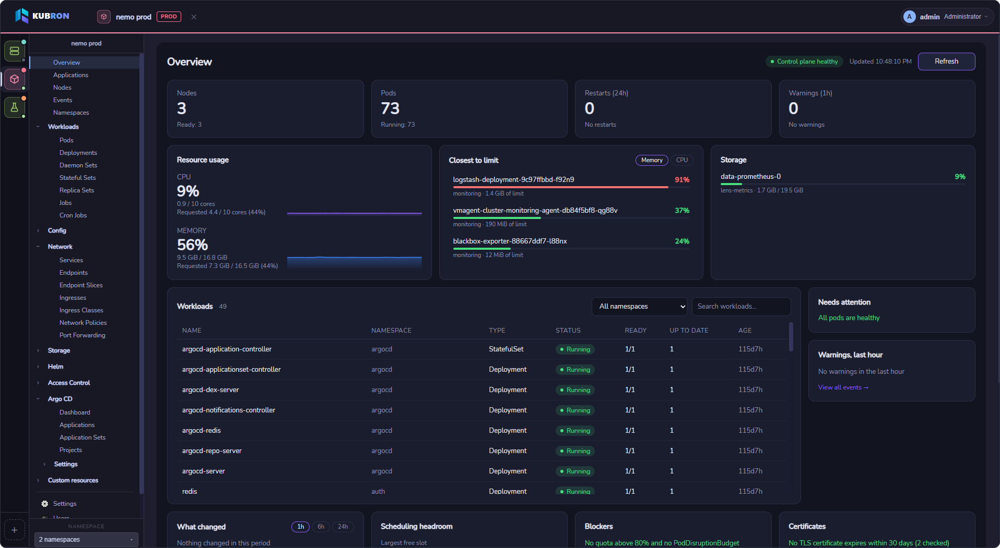
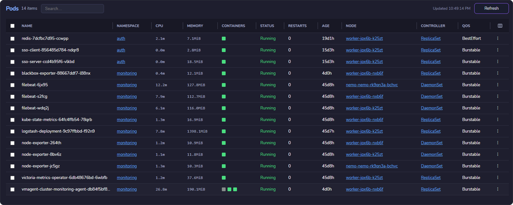
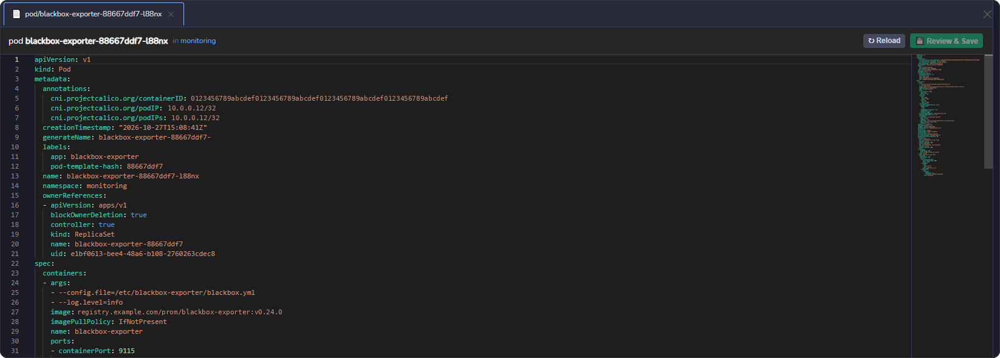
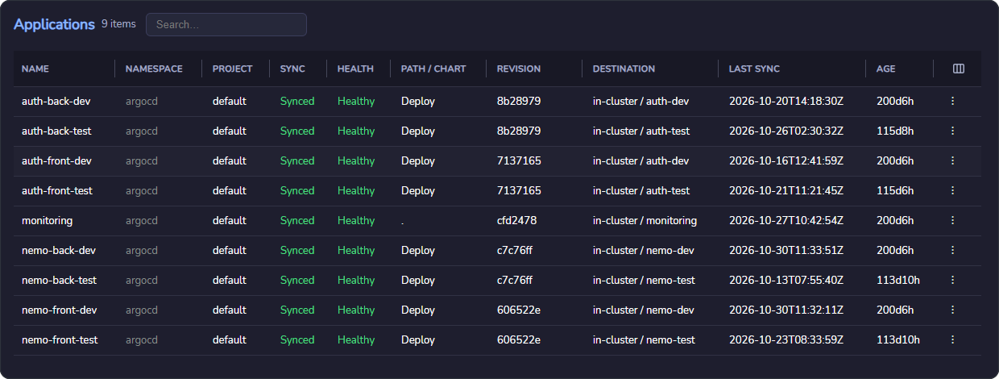

<div align="center">


# Kubron

**Рабочее пространство для повседневных операций с Kubernetes.**

[](https://github.com/24DSO-lab/kubron/actions/workflows/ci.yml)
[](https://github.com/24DSO-lab/kubron/releases)
[](LICENSE)
[](go.mod)
[](#загрузка)
[](https://github.com/24DSO-lab/kubron/releases)
[](https://scorecard.dev/viewer/?uri=github.com/24DSO-lab/kubron)

[Скачать](#загрузка) · [Возможности](#возможности) · [Документация](#документация) · [Сборка](#сборка-из-исходников) · [Серверный режим](#серверный-режим) · [Английская версия](README.md)

</div>

Kubron — это open-source **рабочее пространство для управления Kubernetes** на настольных компьютерах и в Web. Проект создан на **Go**, **Wails** и **Vue**. Управляйте кластерами, разбирайтесь с проблемами workloads и работайте с Helm и GitOps в одном интерфейсе — без постоянного переключения между разрозненными инструментами.

Выберите локальное Desktop-приложение или собственный Web-сервер для команды. Kubron не отправляет телеметрию и не требует облачной учётной записи. В Desktop-режиме kubeconfig остаётся на вашем компьютере; в Web-режиме конфигурации кластеров хранятся на вашем сервере в зашифрованном виде.

<p align="center">
  
</p>

<details>
<summary><b>Другие скриншоты</b>: поды, YAML-редактор, GitOps</summary>

<br>

**Поды**: статусы, перезапуски, узлы, контроллеры, QoS, CPU и память, массовый выбор и настройка столбцов.



**YAML-редактор**: редактируйте ресурсы и проверяйте diff перед сохранением.



**GitOps**: приложения, состояние синхронизации и здоровья, ревизия, назначение и время последней синхронизации.



</details>

## Выберите способ работы

| Desktop | Web / self-hosted |
|---|---|
| Работает локально на вашем компьютере | Работает на инфраструктуре, которую контролируете вы |
| Использует локальный kubeconfig и не загружает его в сервис Kubron | Хранит kubeconfig на вашем сервере в зашифрованном виде |
| Подходит инженерам, которым нужен нативный локальный инструмент | Подходит командам, которым нужно общее многопользовательское пространство |
| Не требует учётной записи Kubron или облачного control plane | Есть локальные пользователи, роли, разрешения и аудит |

**Начните работу:** [скачайте Desktop-приложение](#загрузка) или откройте [руководство по развёртыванию сервера](docs/deploy.md).

## Почему Kubron

- **Всё для повседневных операций** — обзор кластеров, диагностика, ресурсы Kubernetes, Helm и GitOps в одном интерфейсе.
- **Локальный Desktop и собственный Web** — используйте приложение на рабочей станции или разверните сервер для команды.
- **Приватность и контроль** — нет телеметрии и обязательной облачной учётной записи; в Desktop kubeconfig остаётся локально, в Web он хранится зашифрованным на вашем сервере.
- **Встроенные Helm и GitOps** — управляйте релизами Helm, приложениями Argo CD и ресурсами Flux CD без установки дополнительных плагинов.
- **Open source** — лицензия Apache-2.0 и публичный API расширений `pkg/ext`.

## Возможности

### Кластеры
- **Несколько кластеров** — добавляйте кластеры из kubeconfig, переключайтесь между ними в одном окне и задавайте имя, цвет, значок и метку окружения (`dev` / `test` / `stage` / `prod`).
- **Вход в кластер** — встроенная авторизация для OIDC, Azure AKS, AWS EKS и Google GKE. Другие `exec`-плагины на Desktop запускаются только после подтверждения; Web-сервер их не запускает. Подробности — в [руководстве по авторизации](docs/cluster-sign-in.md).
- **Выбор namespace** — один, несколько или все namespace; поддерживается ограниченный RBAC без обязательного cluster-wide `list`.
- **Обновления в реальном времени** — shared informers обновляют списки и Dashboard без избыточной нагрузки на API server.

### Dashboard и диагностика
- **Обзор кластера** — узлы, workloads, ресурсы, хранилища и общее состояние.
- **Поиск проблем** — проблемные поды, блокировки, предупреждения, поды с нагрузкой около лимитов и узлы с малым запасом ресурсов.
- **Недавние изменения** — посмотрите, что изменилось в кластере перед возникновением проблемы.
- **Сертификаты** — контроль сертификатов с истекающим сроком действия.
- **Использование ресурсов** — топ подов и графики нагрузки; для расширенных метрик используется опциональный metrics stack.

### Ресурсы Kubernetes
- **Широкое покрытие ресурсов** — workloads, сеть, конфигурация, хранилища, RBAC, webhooks, leases и runtime-классы.
- **Пользовательские ресурсы** — CRD обнаруживаются автоматически и отображаются с `additionalPrinterColumns`, как в `kubectl get`.
- **Карточки ресурсов** — conditions, events, owners, containers, volumes, affinity, tolerations и другие детали.
- **YAML-редактор** — просмотр и редактирование с diff, применение изменений и создание объектов из манифестов.
- **Массовые операции** — действие над несколькими объектами; ошибка одного объекта не останавливает остальные.
- **Горячие клавиши** — `Alt+P/D/N/E/S` для перехода к Pods, Deployments, Nodes, Events и Settings.

### Операции
- **Инструменты для подов** — live logs, терминал (`exec`) в контейнерах, port forwarding к подам и сервисам, eviction.
- **Deployments** — масштабирование, перезапуск, история ревизий и откат.
- **Nodes** — cordon/uncordon, drain и открытие shell на узле.
- **Метрики** — установка опционального metrics stack и графики для подов, workloads, узлов, PVC и ingress.

### Helm
- **Релизы** — список, values, manifest, notes, история, diff ревизий, rollback и uninstall.
- **Каталог charts** — репозитории, включая basic auth и настройку проверки TLS, поиск charts и просмотр версий.
- **Установка и обновление** — dry-run перед установкой; обновление версии chart с переносом или редактированием values и предварительным просмотром manifest diff.
- **Подсказки об обновлениях** — информация о релизах, для которых доступна более новая версия chart.

### GitOps
- **Argo CD** — приложения, ApplicationSet и проекты со статусами sync и health.
- **Операции Argo CD** — sync с параметрами, refresh / hard refresh, остановка операции, rollback, управление auto-sync и удаление с подтверждением.
- **Diff и граф** — сравнение live и desired состояния и граф ресурсов приложения.
- **Flux CD** — Kustomizations и HelmReleases, состояние, ревизии, управляемые ресурсы и история релизов; источники, уведомления и image automation доступны для чтения. Поддерживаются reconcile, suspend, resume и удаление с подтверждением. Требуется Flux 2.3 или новее; diff и rollback не поддерживаются — используйте Git.

### Безопасность и контроль доступа
- **Пользователи и роли** — встроенные роли `admin`, `operator` и `user` на основе детальных разрешений: чтение, secrets, операции, запись, exec, port-forward, управление кластерами и пользователями, аудит.
- **Безопасные настройки по умолчанию** — хеширование паролей Argon2id, блокировка после неудачных попыток входа, автоматический выход при бездействии с закрытием терминалов и port forwarding.
- **Журнал аудита** — запись действий пользователей и ротация журнала.
- **Расширения** — публичный API `pkg/ext` для внешних модулей, например SSO/OIDC и пользовательских хранилищ.
- **Архитектура и безопасность** — [ADR](docs/adr/README.md), [модель угроз](docs/threat-model.md) и [обзор безопасности](docs/security-review.md).

## Начало работы

### Загрузка

Скачайте последнюю версию со страницы [GitHub Releases](https://github.com/24DSO-lab/kubron/releases):

| Платформа | Файл |
|---|---|
| Windows (x64) | `Kubron_<version>_windows-amd64.zip` |
| Linux (x64) | `Kubron_<version>_linux-amd64.tar.gz` |
| Linux (x64, Debian/Ubuntu) | `kubron_<version>_amd64.deb` |
| macOS (Apple Silicon и Intel) | `Kubron_<version>_macos-universal.zip` |

Для Debian/Ubuntu:

```sh
sudo apt install ./kubron_<version>_amd64.deb
```

Контрольные суммы находятся в `SHA256SUMS.txt`. Для релизов также публикуются build provenance, который можно проверить командой:

```sh
gh attestation verify <file> --repo 24DSO-lab/kubron
```

> Сборки пока не подписаны цифровой подписью. В Windows SmartScreen может показать предупреждение (More info → Run anyway). В macOS нажмите правой кнопкой на приложение и выберите Open либо выполните `xattr -dr com.apple.quarantine Kubron.app`. В Linux требуются GTK 3 и WebKitGTK 4.1 (для Ubuntu 24.04 — `libwebkit2gtk-4.1-0`).

### Сборка из исходников

Требуются [Go](https://go.dev/dl/) (версия из [`go.mod`](go.mod)), [Node.js](https://nodejs.org/) 22+ и [Wails CLI v2](https://wails.io/docs/gettingstarted/installation). В Linux также нужны пакеты разработки GTK и WebKit:

```sh
sudo apt install libgtk-3-dev libwebkit2gtk-4.1-dev
```

```sh
git clone https://github.com/24DSO-lab/kubron.git
cd kubron
wails doctor
wails dev
wails build
```

В Linux добавляйте `-tags webkit2_41` к командам `wails dev` и `wails build`.

## Документация

- **Руководства пользователя (PDF)**: Helm — [English](docs/DOCS/EN/Kubron-Helm-User-Guide-EN.pdf), [Русский](docs/DOCS/RU/Kubron-Helm-User-Guide.pdf); GitOps — [English](docs/DOCS/EN/Kubron-ArgoCD-User-Guide-EN.pdf), [Русский](docs/DOCS/RU/Kubron-ArgoCD-User-Guide.pdf).
- **Развёртывание сервера**: [установка](docs/deploy.md), [высокая доступность](docs/ha.md), [резервное копирование и восстановление](docs/backup.md), [логирование](docs/logging.md), [метрики](docs/metrics.md), [HTTP security](docs/http-security.md).
- **Безопасность сервера**: [модель угроз](docs/threat-model.md), [обзор безопасности](docs/security-review.md).
- **Авторизация в кластерах**: [руководство](docs/cluster-sign-in.md), [лабораторная работа по облачной авторизации](docs/authentication-lab.md).
- **Карта документации и статус проекта**: [docs/README.md](docs/README.md); открытые задачи — [docs/tickets](docs/tickets), история изменений — [CHANGELOG.md](CHANGELOG.md).
- **Локализация**: [docs/i18n.md](docs/i18n.md), [ADR-0014](docs/adr/0014-i18n.md).
- **Релизы**: [docs/releasing.md](docs/releasing.md), [Supply Chain (ADR-0021)](docs/adr/0021-release-supply-chain.md).

## Серверный режим

Помимо Desktop-приложения, Kubron поставляется с `kubron-server` — тем же интерфейсом, работающим по HTTP для команд. Сервер хранит пользователей, кластеры и журнал аудита в **PostgreSQL 14+**, шифрует kubeconfig и токены интеграций GitOps при хранении (ключ `KUBRON_SECRET_KEY`). Сервер предполагает работу за reverse proxy с TLS.

Контейнерный образ (`ghcr.io/24dso-lab/kubron`) и Helm chart (`oci://ghcr.io/24dso-lab/charts/kubron`) публикуются для каждого тега `vX.Y.Z`, подписываются с помощью cosign и сопровождаются provenance и SBOM attestations. Исходники chart находятся в [`deploy/helm/kubron`](deploy/helm/kubron); по умолчанию запускаются две реплики.

При первом запуске с новой базой данных первый администратор создаётся с помощью setup token (`KUBRON_SETUP_TOKEN`) или команды `kubron-server create-admin`; chart генерирует токен. Запуск в Docker/Kubernetes, высокая доступность, управление ключами, резервное копирование и проверка подписей описаны в [руководстве по развёртыванию](docs/deploy.md), [HA](docs/ha.md) и [backup](docs/backup.md).

Для локального запуска из исходников без базы данных используется файловое хранилище в домашнем каталоге, сервер слушает только loopback:

```sh
mkdir -p frontend/dist && touch frontend/dist/.keep
wails generate module
cd frontend && npm ci && npm run build:web && cd ..
go run ./cmd/kubron-server --listen 127.0.0.1:8080
```

> Для прослушивания внешнего адреса требуется `KUBRON_ALLOW_REMOTE=1` и TLS proxy перед сервером.

## Дорожная карта

- [x] Desktop-приложение (Wails + Go + Vue) с локальной авторизацией и журналом аудита
- [x] Управление релизами Helm
- [x] Управление GitOps-приложениями
- [ ] Поддержка дополнительных GitOps-инструментов
- [x] Web-режим с несколькими пользователями, командами и сессионной авторизацией
- [x] Высокая доступность сервера (несколько реплик)
- [x] Общий постоянный каталог Helm в серверном режиме
- [x] Публикация подписанных контейнерного образа и Helm chart в registry
- [x] HTTP port-forward и терминалы в Web-режиме
- [ ] Независимый аудит и pentest сценариев авторизации в кластерах (credential broker, AKS, EKS, GKE); проверка остальной части сервера проведена 2026-11-03 ([статус](docs/security-review.md))
- [ ] Подписанные сборки Windows и macOS
- [ ] SSO/OIDC для организаций

Есть идея или предложение? Создайте [Feature Request](https://github.com/24DSO-lab/kubron/issues/new/choose).

## Лицензия

Kubron распространяется под лицензией [Apache-2.0](LICENSE).

## Участие в разработке

См. [CONTRIBUTING.md](CONTRIBUTING.md). Для внешних pull request из fork требуется DCO sign-off. Пожалуйста, соблюдайте [Code of Conduct](CODE_OF_CONDUCT.md). О сообщениях об уязвимостях — в [SECURITY.md](SECURITY.md). История релизов и изменений — [CHANGELOG.md](CHANGELOG.md).
