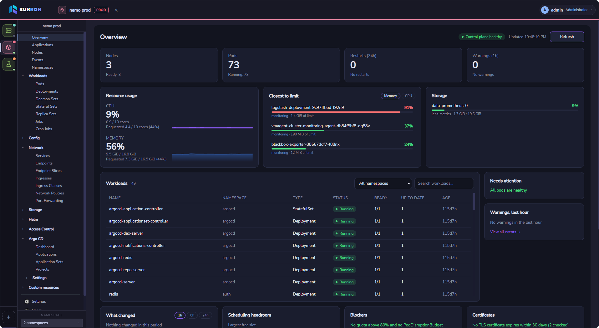

# What is Kubron

Kubron is a fast, private, open-source **Kubernetes Operations Workspace** for desktop and web. It puts the everyday work of a Kubernetes operator in one place: see what is wrong with a cluster, understand what changed, and act on it, without juggling `kubectl`, a Helm CLI, a GitOps UI and a pile of terminals.

It is written in **Go** and uses [Wails](https://wails.io) with a **Vue 3** interface. The Desktop edition is a compact native application on top of the webview that is already part of your operating system (WebView2 on Windows, WebKit on macOS and Linux). It connects to your clusters directly from your machine with the kubeconfig you already have. There is no Kubron cloud in between.

## Two editions

| | **Desktop** | **Web** (self-hosted) |
|---|---|---|
| What it is | A native app for Windows, Linux and macOS | The same interface served over HTTP for a team |
| Who uses it | One person on their own machine | Several people through a browser |
| Accounts | One local administrator, created on first launch | Local users, roles and teams stored in PostgreSQL |
| Where kubeconfigs live | On your machine, readable only by you | In PostgreSQL, encrypted with your key |
| Who runs it | You, nothing to deploy | Your team operates the server. Kubron is not a hosted SaaS |
| Needs | Nothing besides the app | PostgreSQL 14+, a TLS reverse proxy, an encryption key |
| Guide | [Desktop edition](/guide/desktop) | [Web edition](/guide/web) · [Local quick start](/server/quick-start) · [Production deployment](/server/deploy) |

Most people should start with Desktop. Web is for teams that want one shared, access-controlled entry point to their clusters.

## Who it is for

- **Platform and DevOps engineers** who work with several clusters and environments every day.
- **Developers** who need to read logs, check a rollout or open a shell without learning every `kubectl` flag.
- **Teams on restricted RBAC**, where cluster-wide `list` is not allowed and many tools stop working.
- **Organizations** that care where credentials go and want to verify what they install.

## Why Kubron

### Lightweight and native
A single Go binary with the system webview, not a bundled browser engine. It starts quickly and stays out of the way of the tools it is managing.

### Private by default
No telemetry and no mandatory account. In desktop mode your kubeconfig never leaves your machine. Kubron's data directory is private to your user account.

### Built to avoid mistakes
Name, colour and tag every cluster (`dev`, `test`, `stage`, `prod`) so production never looks like staging. Edit YAML with a diff you must review before saving. Run bulk actions where one failure does not stop the rest, and see partial permission errors instead of an empty list.

### Works with restricted access
Namespace scoping does not require cluster-wide `list`. If you can only see two namespaces, Kubron shows those two and tells you what it could not read.

### Cluster sign-in built in
Kubron recognizes the credential type in your kubeconfig and guides you through sign-in: tokens and certificates, OIDC (password, browser and device code), Azure AKS, AWS EKS and Google GKE. On the Web edition the server never runs commands from an uploaded kubeconfig. See [Connecting to Kubernetes](/features/cluster-auth).

### Helm and GitOps built in
Install, upgrade, diff and roll back Helm releases, and manage Argo CD applications, ApplicationSets and projects, all without installing plugins or extra components in the cluster for the UI.

### Live, not stale
Shared informers keep lists and the dashboard current without hammering the API server with polling.

### Verifiable supply chain
Release files ship with checksums and build provenance. Server images and the Helm chart are signed with cosign and carry provenance and SBOM attestations, so you can check what you run before you run it. See [Verify your download](/guide/installation#verify-your-download).

### Open source, in your language
Apache-2.0 licensed, with a public `pkg/ext` API for extensions. The interface is available in English, Русский and 中文 and follows your system language by default.

## What you can do

| Area | Highlights |
|---|---|
| [Clusters](/features/multi-cluster) | Many clusters in one window, namespace scoping, environment tags |
| [Dashboard](/features/dashboard) | Health, problem pods, hot pods, recent changes, expiring certificates |
| [Resources & YAML](/features/resources) | Built-in types and CRDs, detail panels, YAML editor with diff, bulk actions |
| Operations | Live logs, pod terminals, port forwarding, scale, restart, rollback, cordon and drain |
| [Helm](/features/helm) | Releases, history and diff, chart catalog with OCI, dry-run install and upgrade |
| [GitOps](/features/gitops) | Argo CD applications, sync and refresh, live-vs-desired diff, resource graph |
| [Cluster authentication](/features/cluster-auth) | OIDC, AKS, EKS, GKE, exec plugins, personal or shared team sign-in |
| [Teams](/features/teams) | Web edition: team-owned clusters and per-team roles |
| [Security](/features/security) | Local users and roles, audit log, lockout, auto-logout |

## What to expect today

Kubron is honest about where it is:

- **Builds are not code-signed yet.** Windows SmartScreen and macOS Gatekeeper will ask you to confirm the first launch. The [Desktop guide](/guide/desktop) shows exactly how, and how to verify the files instead.
- **Sign-in to Kubron itself uses local accounts.** Organization SSO/OIDC for Kubron's own login is not built in yet; cluster sign-in through an identity provider is supported.
- **GitOps means Argo CD only for now.** Support for more tools is on the roadmap, as are code-signed builds.
- **Desktop builds target 64-bit systems:** Windows x64, Linux x64 and macOS (universal, Apple Silicon and Intel).
- **Web is self-hosted.** Read the [production requirements](/server/) before exposing it to users.

## Next steps

1. [Choose and install an edition](/guide/getting-started)
2. [Add your first cluster](/guide/first-cluster)
3. [Explore the features](/features/)
