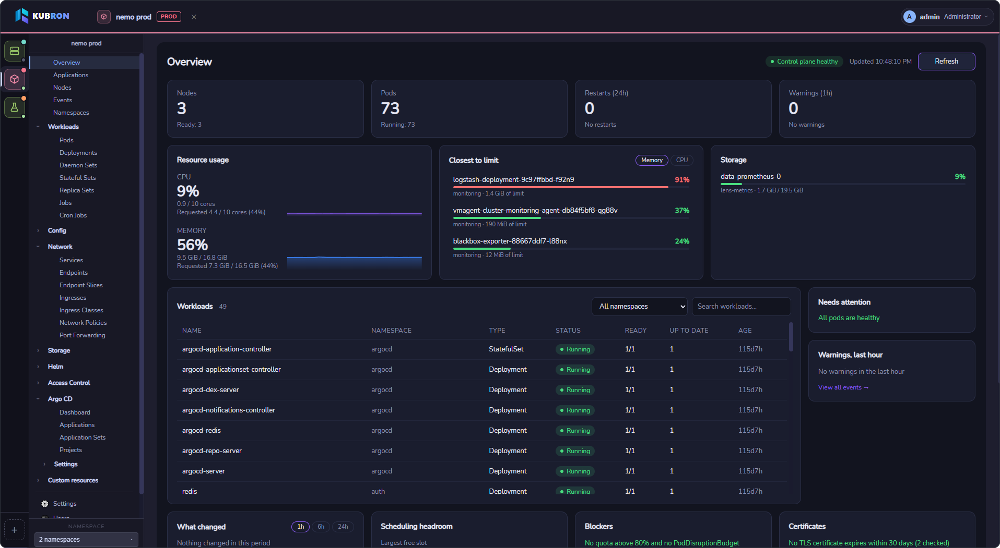
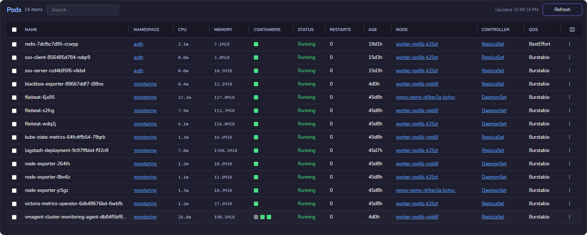
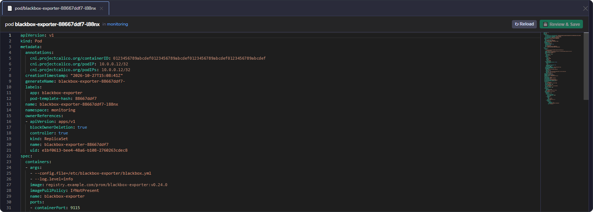
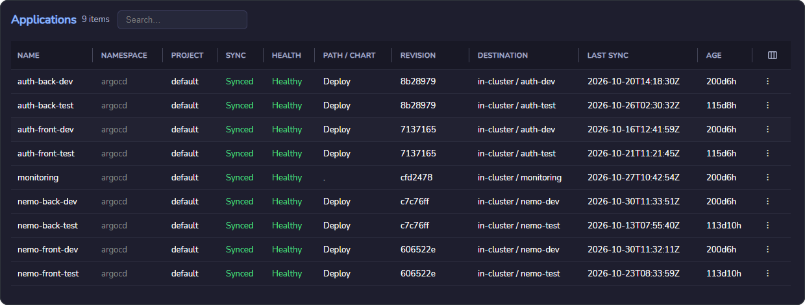

  GO + WAILS + VUE
  WINDOWS · LINUX · macOS
  APACHE-2.0
  NO TELEMETRY

## Kubernetes operations, without the clutter

Kubron brings everyday Kubernetes operations into one workspace across desktop and web: inspect cluster health, understand what changed, troubleshoot issues and take action without switching between a dozen tools.

  <figure>
    
    <figcaption><strong>Cluster overview</strong> Health, capacity, blockers and recent changes at a glance.</figcaption>
  </figure>
  <figure>
    
    <figcaption><strong>Resource browser</strong> Inspect pods and workloads, then drill into the details.</figcaption>
  </figure>
  <figure>
    
    <figcaption><strong>YAML editor</strong> Review the diff before applying a manifest change.</figcaption>
  </figure>
  <figure>
    
    <figcaption><strong>GitOps</strong> See application health and sync state in context.</figcaption>
  </figure>

## Two editions. One Kubernetes workspace.

### Desktop

Run Kubron locally on Windows, Linux or macOS. No server deployment or mandatory account is required; your kubeconfig stays on your machine.

[Get started with Desktop →](/guide/desktop)

### Web

Deploy Kubron in your own infrastructure and access it through a browser. Web adds multi-user accounts, roles, permissions and shared state backed by PostgreSQL. It is self-hosted, not a hosted SaaS service.

[Get started with Web →](/guide/web)

## Built for the way Kubernetes is operated

- **Multi-cluster workflows** — name and color-code clusters, tag environments, and choose one or several namespaces. Restricted RBAC is supported; partial access failures are surfaced.
- **Live resource views** — shared informers keep lists and the dashboard current without aggressive polling.
- **Broad resource coverage** — built-in Kubernetes resources plus automatically discovered CRDs.
- **Practical operations** — logs, exec, port-forward, workload scaling and restarts, node cordon and drain.
- **Helm lifecycle** — repositories (including OCI), chart discovery, dry-run install, upgrades, revision diffs and rollback.
- **Argo CD integration** — applications, ApplicationSets, projects, sync controls, live-vs-desired diff and resource graph.
- **Flux CD integration** — Kustomizations, HelmReleases, sources, notifications and image automation, with reconcile, suspend, resume and a source-to-resources chain.
- **Optional metrics** — charts for pods, workloads, nodes, PVCs and ingresses when the metrics stack is installed.

## Why teams choose Kubron

- **Light and native.** Go plus the system webview: no bundled browser engine, quick to start, easy on memory.
- **Private by design.** No telemetry, no mandatory account, and on Desktop your kubeconfig stays on your machine.
- **Safe to operate.** Environment tags, a mandatory diff before saving YAML, and bulk actions that report failures instead of stopping.
- **Works with restricted access.** Restricted RBAC is a first-class case: no cluster-wide `list` required.
- **Signs in to your clusters.** OIDC, Azure AKS, AWS EKS and Google GKE are handled natively, and the Web server never runs commands from an uploaded kubeconfig.
- **Verifiable.** Release checksums and provenance, plus signed server images and chart with SBOMs.
- **Open and multilingual.** Apache-2.0, a public extension API, and an interface in English, Русский and 中文.

[What is Kubron? →](/guide/what-is-kubron)

## Built with Go, Wails and Vue

The desktop application is built with Go, Wails and Vue. Server mode serves the same UI over HTTP for multi-user teams, with PostgreSQL-backed state, encrypted credentials and support for multiple replicas. It is designed to run behind a TLS-terminating reverse proxy.

[Explore the Web edition →](/server/)

## Privacy and access control

Desktop does not require an account, sends no telemetry and keeps your kubeconfig on your machine. Web adds local user accounts, fine-grained roles and permissions, session management and an audit log for shared environments.

[Read about security →](/features/security)

## Get started

Ready to connect a cluster?

- [Download the latest release](https://github.com/24DSO-lab/kubron/releases)
- [Choose Desktop or Web](/guide/getting-started)
- [Requirements and verification](/guide/installation)
- [Explore all features](/features/)
- [Read the source and contribute](https://github.com/24DSO-lab/kubron)

  Kubron is open source under the Apache-2.0 license.

