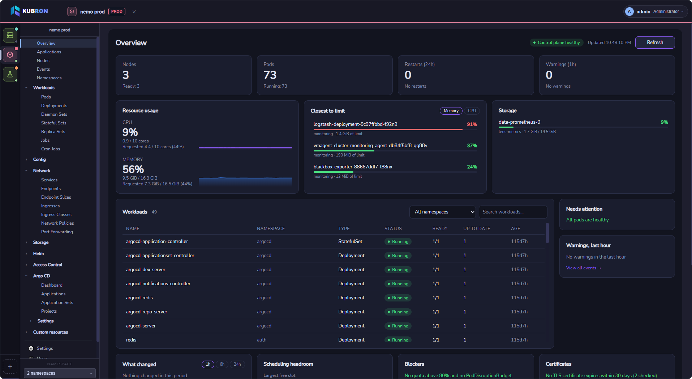

# Что такое Kubron

Kubron — быстрое, приватное open-source **рабочее пространство для операций в Kubernetes** (Kubernetes Operations Workspace) для desktop и web. Оно собирает повседневную работу оператора Kubernetes в одном месте: увидеть, что не так с кластером, понять, что изменилось, и действовать, не жонглируя `kubectl`, Helm CLI, GitOps-интерфейсом и десятком терминалов.

Приложение написано на **Go** и использует [Wails](https://wails.io) с интерфейсом на **Vue 3**. Desktop-версия — компактное нативное приложение поверх webview, который уже есть в операционной системе (WebView2 в Windows, WebKit в macOS и Linux). Она подключается к кластерам напрямую с вашей машины, используя уже имеющийся kubeconfig. Никакого «облака Kubron» посередине нет.

## Две версии

| | **Desktop** | **Web** (self-hosted) |
|---|---|---|
| Что это | Нативное приложение для Windows, Linux и macOS | Тот же интерфейс по HTTP для команды |
| Кто пользуется | Один человек на своей машине | Несколько человек через браузер |
| Учётные записи | Один локальный администратор, создаётся при первом запуске | Локальные пользователи, роли и команды в PostgreSQL |
| Где лежат kubeconfig | На вашей машине, доступны только вам | В PostgreSQL, зашифрованы вашим ключом |
| Кто запускает | Вы, ничего разворачивать не нужно | Сервер обслуживает ваша команда. Kubron — не облачный SaaS |
| Что нужно | Только само приложение | PostgreSQL 14+, TLS-прокси, ключ шифрования |
| Руководство | [Desktop-версия](/ru/guide/desktop) | [Web-версия](/ru/guide/web) · [Локальный быстрый старт](/ru/server/quick-start) · [Продакшн-развёртывание](/ru/server/deploy) |

Большинству стоит начать с Desktop. Web нужна командам, которым требуется единая точка входа в кластеры с разграничением доступа.

## Для кого

- **Platform- и DevOps-инженеры**, которые ежедневно работают с несколькими кластерами и окружениями.
- **Разработчики**, которым нужно прочитать логи, проверить раскатку или открыть shell, не изучая все флаги `kubectl`.
- **Команды с ограниченным RBAC**, где cluster-wide `list` запрещён и многие инструменты перестают работать.
- **Организации**, для которых важно, куда уходят учётные данные, и которые хотят проверять то, что устанавливают.

## Преимущества

### Лёгкий и нативный
Один Go-бинарник с системным webview вместо встроенного браузерного движка. Быстро запускается и не мешает инструментам, которыми вы управляете.

### Приватный по умолчанию
Без телеметрии и обязательной учётной записи. В десктопном режиме kubeconfig не покидает вашу машину. Каталог данных Kubron доступен только вашему пользователю.

### Меньше ошибок
Дайте каждому кластеру имя, цвет и тег (`dev`, `test`, `stage`, `prod`), чтобы прод не выглядел как стейдж. Правьте YAML с обязательным просмотром diff перед сохранением. Массовые действия не останавливаются на первой ошибке, а частичные ошибки доступа видны, а не превращаются в пустой список.

### Работает с ограниченным доступом
Ограничение по namespace не требует cluster-wide `list`. Если вам доступны два namespace, Kubron покажет их и скажет, что прочитать не удалось.

### Вход в кластеры встроен
Kubron распознаёт тип учётных данных в kubeconfig и проводит вас через вход: токены и сертификаты, OIDC (пароль, браузер и код устройства), Azure AKS, AWS EKS и Google GKE. В Web-версии сервер никогда не выполняет команды из загруженного kubeconfig. См. [Подключение к Kubernetes](/ru/features/cluster-auth).

### Helm и GitOps встроены
Установка, обновление, diff и rollback релизов Helm, а также приложения, ApplicationSet и проекты Argo CD — без плагинов и дополнительных компонентов в кластере ради интерфейса.

### Актуальные данные
Shared informers поддерживают списки и дашборд в актуальном состоянии без агрессивного опроса API-сервера.

### Проверяемая цепочка поставки
К файлам релиза прилагаются контрольные суммы и provenance сборки. Образы сервера и Helm-чарт подписаны cosign и снабжены аттестациями provenance и SBOM: проверить можно до запуска. См. [Проверка загрузки](/ru/guide/installation#проверка-загрузки).

### Открытый код и ваш язык
Лицензия Apache-2.0, публичный API `pkg/ext` для расширений. Интерфейс доступен на English, Русский и 中文 и по умолчанию следует языку системы.

## Что можно делать

| Область | Основное |
|---|---|
| [Кластеры](/ru/features/multi-cluster) | Много кластеров в одном окне, выбор namespace, теги окружений |
| [Дашборд](/ru/features/dashboard) | Состояние, проблемные и «горячие» Pod, недавние изменения, истекающие сертификаты |
| [Ресурсы и YAML](/ru/features/resources) | Встроенные типы и CRD, панели деталей, YAML-редактор с diff, массовые действия |
| Операции | Живые логи, терминалы Pod, port-forward, масштабирование, перезапуск, rollback, cordon и drain |
| [Helm](/ru/features/helm) | Релизы, история и diff, каталог чартов с OCI, dry-run установки и обновления |
| [GitOps](/ru/features/gitops) | Приложения Argo CD, sync и refresh, сравнение live и desired, граф ресурсов |
| [Аутентификация в кластерах](/ru/features/cluster-auth) | OIDC, AKS, EKS, GKE, exec-плагины, личный или общий командный вход |
| [Команды](/ru/features/teams) | Web: кластеры команд и роли в команде |
| [Безопасность](/ru/features/security) | Локальные пользователи и роли, журнал аудита, блокировка, автовыход |

## Чего ожидать сегодня

- **Сборки пока не подписаны.** Windows SmartScreen и macOS Gatekeeper попросят подтвердить первый запуск. [Руководство по Desktop](/ru/guide/desktop) показывает, как именно, и как вместо этого проверить файлы.
- **Вход в сам Kubron — локальные учётные записи.** Корпоративный SSO/OIDC для входа в Kubron пока не встроен; вход в кластеры через провайдера идентификации поддерживается.
- **GitOps пока означает только Argo CD.** Поддержка других систем и подписанные сборки — в планах.
- **Desktop-сборки только 64-разрядные:** Windows x64, Linux x64 и macOS (универсальная сборка для Apple Silicon и Intel).
- **Web разворачивается у вас.** Прочитайте [требования к продакшну](/ru/server/), прежде чем открывать её пользователям.

## Дальше

1. [Выберите версию и установите](/ru/guide/getting-started)
2. [Добавьте первый кластер](/ru/guide/first-cluster)
3. [Изучите возможности](/ru/features/)
